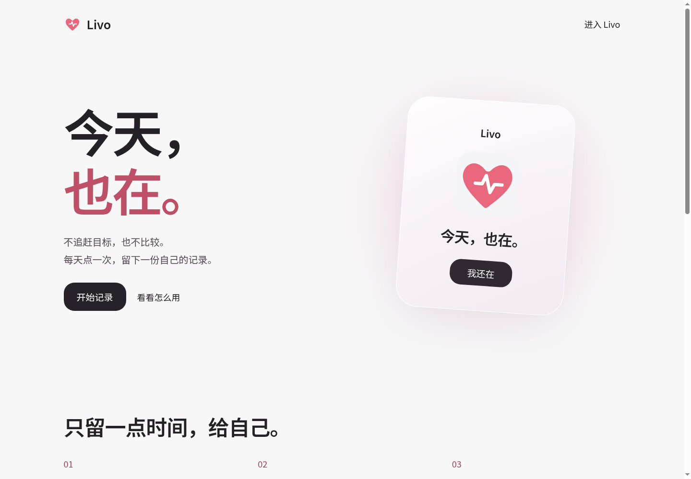

# Livo

**今天，也在。** 一个轻量的每日打卡网站。每天点一次爱心，留一句话，在日历里回看记录，也可以生成分享图片。

体验：<https://livo.workstudioai.top/> · 介绍：<https://livo.workstudioai.top/about>



## 功能

- 用户名或邮箱 + 密码统一登录；新账号自动创建，无需邮箱验证码。邮箱仅作为账号标识，不代表验证了邮箱所有权。
- 每天一次打卡、心跳动画、可选留言、日历、累计和连续天数。
- 六种背景、自定义照片裁剪，偏好随账号保存。
- 本地生成 1080×1440 PNG 分享图，默认不含账号、邮箱和留言；可选择附上当天留言。
- 独立介绍页，桌面与手机自适应，键盘操作和减少动态效果支持。
- 管理员可查看真实用户、打卡和最近登录的粗略地区；不展示明文密码。

## 本地运行

Python 3.10+，建议 3.11 或更新。无需 Node、Share 或构建步骤。

```bash
python3 -m venv .venv
source .venv/bin/activate
python -m pip install -r requirements.txt
python server.py
```

打开 <http://127.0.0.1:8085/>。首次输入新用户名和至少 6 位密码即创建普通账号。默认数据保存在 `var/`，已被 Git 忽略。

需要管理员时，先在终端运行（不含默认账号和密码）：

```bash
python server.py init-admin
```

若已经存在管理员，命令不会覆盖。正式部署请设置自己的强密码。

Windows PowerShell 可使用 `.venv\Scripts\Activate.ps1` 激活虚拟环境。浏览器端兼容现代 Chrome、Edge、Safari 和 Firefox；生产环境建议 HTTPS。

## 配置和部署

程序读取环境变量，不自动读取 `.env`，可参考 [.env.example](.env.example)。

```bash
export LIVO_STATE_DIR=/absolute/private/livo-data
export LIVO_ORIGINS=https://your-domain.example
python server.py --port 8085
```

服务只监听本机 `127.0.0.1`。可将 Cloudflare Tunnel 的 HTTP 服务指向 `http://localhost:8085`；无需再部署一份静态文件。`LIVO_ORIGINS` 为允许提交操作的公开来源，多个用逗号分隔，不带末尾 `/`。自用开发的当前本机端口会自动允许。

systemd 示例见 [docs/livo.service.example](docs/livo.service.example)。先创建私有数据目录并赋予服务账号写权限，再调整路径和域名。不要把程序以 root 身份运行。

**在当前树莓派上**，唯一在用的代码目录是 `/home/ubuntu/livo`，原有账号数据继续保存在原私有目录；不在 Git 仓库中。现有 8083 入口只转发 Livo 请求到 8085，不再读取旧静态副本。修改后执行：

```bash
systemctl --user restart livo-api.service
```

旧 Desktop 设计稿和 `pi-web/animation/alive-design` 是历史文件，不再是线上源代码。无需修改两份。

## 地区统计与隐私

默认不依赖外部定位 API。可选设置 `LIVO_GEO_DIR`，放入上游 [ip2region](https://github.com/lionsoul2014/ip2region) 的 IPv4 和 IPv6 XDB 数据库，文件名为 `ip2region_v4.xdb`、`ip2region_v6.xdb`。数据库体积较大，未随仓库提供；须自行检查其授权和更新方式。Python 查询器的原始许可保存在 `ip2region/LICENSE.md`。

缺少 XDB 时仍可运行；通过本机可信代理转发的 Cloudflare 国家代码可用于国家级统计，城市可能为空。IP 定位并不代表用户真实位置。除非已在 Cloudflare 设置覆盖相应头的受信转换，否则不要启用 `LIVO_CF_LOCATION_HEADERS=1`。本机服务不能直接暴露到不可信代理网络。

成功登录事件保留 30 天；IP 只保存掩码。管理员能看到账号标识、记录统计和登录地区。不要把这些数据当成完全匿名的数据。自定义背景原图不上传，服务器保存重新编码的裁剪图片，仅账号本人可读取；分享图片由浏览器生成，不会自动公开。

当前未实现邮箱验证、邮件找回、两步验证、账号自助删除、离线打卡或医疗报警。忘记密码需要管理员在服务器端按实际身份验证流程处理。产品仅用于个人日常记录，不是安全监护或医疗服务。

## 验证和备份

```bash
python -m unittest discover -s tests -v
python tools/livo-backup.py
```

测试使用临时数据，不访问正式账号。备份采用 SQLite 在线备份并校验完整性，包含账号、记录和自定义背景；文件应保持私有。默认保留最近 14 份日常备份，发布备份不自动删除。设置相同 `LIVO_STATE_DIR` 才会备份指定的正式数据。

可选浏览器检查：Node 22+、本机 Chromium，运行 `node tools/browser-review.mjs --url=http://127.0.0.1:8085/`。截图示例来自隔离的演示账号。

## 目录

```text
web/           页面、样式、字体、分享图功能
livo/          账号、记录、背景、统计 API
ip2region/     可选定位读取器及上游许可
tests/         隔离数据集成检查
tools/         备份、浏览器检查、字体子集工具
docs/          部署示例、截图、推广文案、验收记录
server.py      统一启动及创建管理员入口
```

发布前请把 HTML 的 `og:image`、`promotion.js` 图片底部的演示域名、本文体验链接替换为自己的域名。字体是自行托管的 Noto Sans SC 子集，见 `web/fonts/OFL.txt`；苹果系统优先使用系统字体。仓库不包含用户数据、真实账号密码、令牌或 Claude 日志。

## 上传 GitHub

已完成本地初始化和提交。在 GitHub 新建**空仓库**，不要预先添加 README，然后将下面的地址替换成实际地址：

```bash
git remote add origin https://github.com/YOUR-ACCOUNT/YOUR-REPOSITORY.git
git push -u origin main
```

仅代码与文档会被推送；请勿另行加入 `var/` 或正式数据库。Share 的作品链接可在仓库创建后再补充。

## 许可

Livo 自有代码采用 MIT；字体和 vendored ip2region 的上游许可分别保留，不受本项目 MIT 替代。
